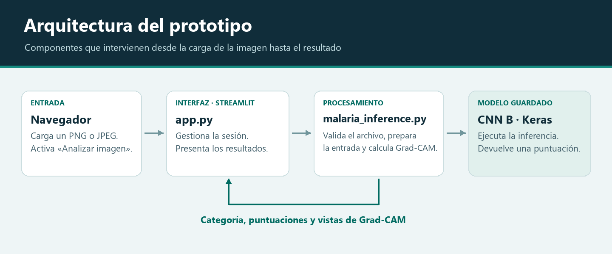
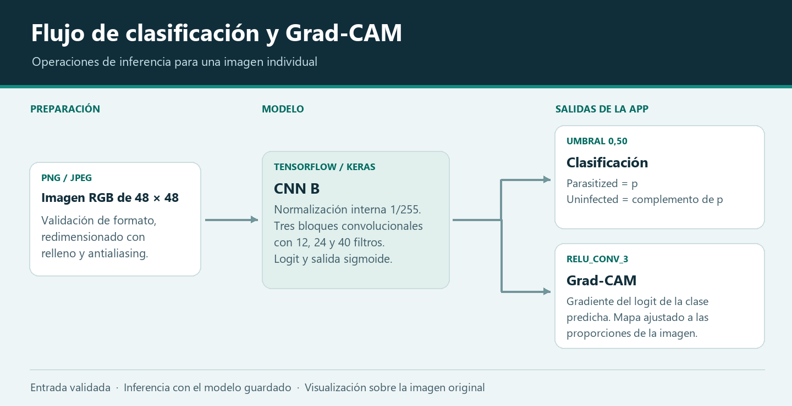

# Arquitectura del prototipo

## Componentes

| Componente | Responsabilidad |
| --- | --- |
| [app.py](app.py) | Gestiona la carga y la sesión de Streamlit. Ejecuta el análisis al pulsar el botón, muestra las dos puntuaciones y borra el resultado anterior al cambiar de imagen. |
| [malaria_inference.py](malaria_inference.py) | Valida el archivo, convierte píxeles a RGB, ajusta el tamaño, ejecuta la CNN y calcula la visualización Grad-CAM. Se puede usar desde el notebook del prototipo. |
| [modelo_malaria_cnn.keras](models/modelo_malaria_cnn.keras) | Contiene la CNN B elegida por pérdida de validación. La arquitectura tiene tres bloques convolucionales de 12, 24 y 40 filtros. |
| [config.toml](.streamlit/config.toml) | Define el tema de la interfaz y el límite de carga del servidor. |
| [Pruebas](tests/test_malaria_inference.py) | Comprueban la validación de entradas, la geometría de Grad-CAM y la concordancia con las predicciones de la fase 1. |

## Recorrido de una imagen

1. **Validación.** La app comprueba que el formato real coincida con la extensión y que el archivo pueda abrirse. Acepta una imagen estática de hasta 10 MB y 12 megapíxeles.
2. **Preparación.** El módulo decodifica tres canales RGB y ajusta la imagen a 48 × 48 con relleno y antialiasing. La capa de normalización está dentro del modelo.
3. **Predicción.** Streamlit reutiliza el modelo cargado y lo ejecuta en modo de inferencia. Su salida sigmoide es la puntuación de `Parasitized`. La puntuación de `Uninfected` es su complemento. El umbral de clasificación es 0,50.
4. **Grad-CAM.** Se usan la activación `relu_conv_3` del último bloque convolucional y el logit de la categoría predicha. El mapa se ajusta a las proporciones de la imagen tras retirar el relleno. Si el mapa no se puede generar, la app conserva la clasificación y muestra un aviso.
5. **Presentación.** La interfaz muestra la imagen original, la categoría, las puntuaciones y las vistas de Grad-CAM. El análisis se ejecuta en memoria durante la sesión.

El [notebook de entrenamiento](PROYECTO_MALARIA_CNN.ipynb) genera el modelo. El [notebook del prototipo](GUIA_PROTOTIPO_MALARIA.ipynb) demuestra cómo usarlo sin volver a entrenar.
