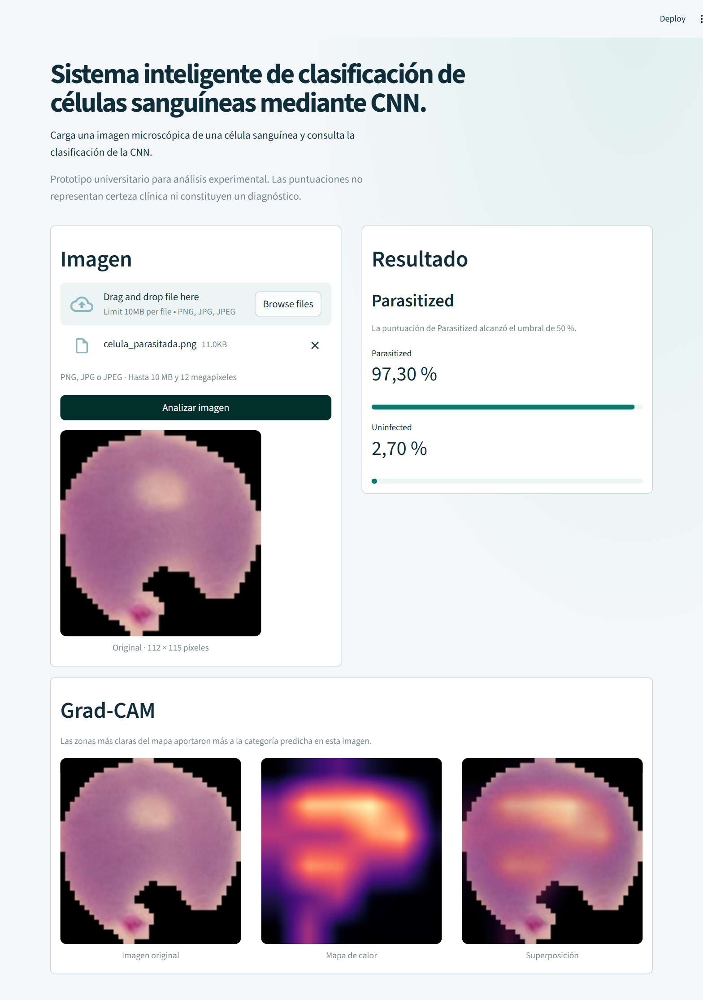

# Clasificación de células sanguíneas mediante CNN

Proyecto universitario que clasifica imágenes microscópicas de células individuales como **Parasitized** o **Uninfected**. Incluye el entrenamiento reproducible, el modelo guardado y un prototipo en Streamlit con visualizaciones Grad-CAM.

## Aplicación en línea

**Streamlit Community Cloud:** [Abrir el prototipo CNN Malaria](https://cnn-malaria-unfv.streamlit.app/).

## Prototipo en funcionamiento

[Ver la captura con clasificación Uninfected](docs/imagenes/prototipo-uninfected.png) · [Ver los diagramas de arquitectura](ARQUITECTURA.md)

## Guías y código fuente

| Archivo | Contenido |
| --- | --- |
| [Notebook de entrenamiento](PROYECTO_MALARIA_CNN.ipynb) | Flujo completo desde el análisis del dataset hasta el entrenamiento, la evaluación y el guardado del modelo. |
| [Notebook del prototipo](GUIA_PROTOTIPO_MALARIA.ipynb) | Guía ejecutable de carga, preprocesamiento, predicción y Grad-CAM con el modelo entrenado. |
| [Arquitectura](ARQUITECTURA.md) | Componentes, responsabilidades y recorrido de una imagen por el prototipo. |
| [Guía de reproducción](REPRODUCCION.md) | Preparación del entorno, ejecución de los notebooks, inicio de la app y pruebas. |
| [Guía de publicación](PUBLICACION.md) | Pasos para publicar el repositorio en GitHub y desplegarlo en Streamlit Community Cloud. |

## Resultados de la fase 1

Se usaron **27 558 imágenes** del dataset NIH Malaria Cell Images. La división por paciente dejó 19 577 imágenes para entrenamiento, 3 977 para validación y 4 004 para prueba. En la prueba reservada, la CNN obtuvo **94,38 % de accuracy**, un **F1 de 0,9421** y un **ROC-AUC de 0,9869**. [Métricas completas](results/metrics/metricas_prueba.csv)

El prototipo utiliza el [modelo entrenado](models/modelo_malaria_cnn.keras) y acepta PNG, JPG y JPEG de hasta 10 MB y 12 megapíxeles. Está destinado al análisis académico de células individuales. Las puntuaciones del modelo no constituyen un diagnóstico.

---

**Elaborado por Jaime Alejandro Galvez Egas**  
**Universidad Nacional Federico Villarreal 2026 ©**
